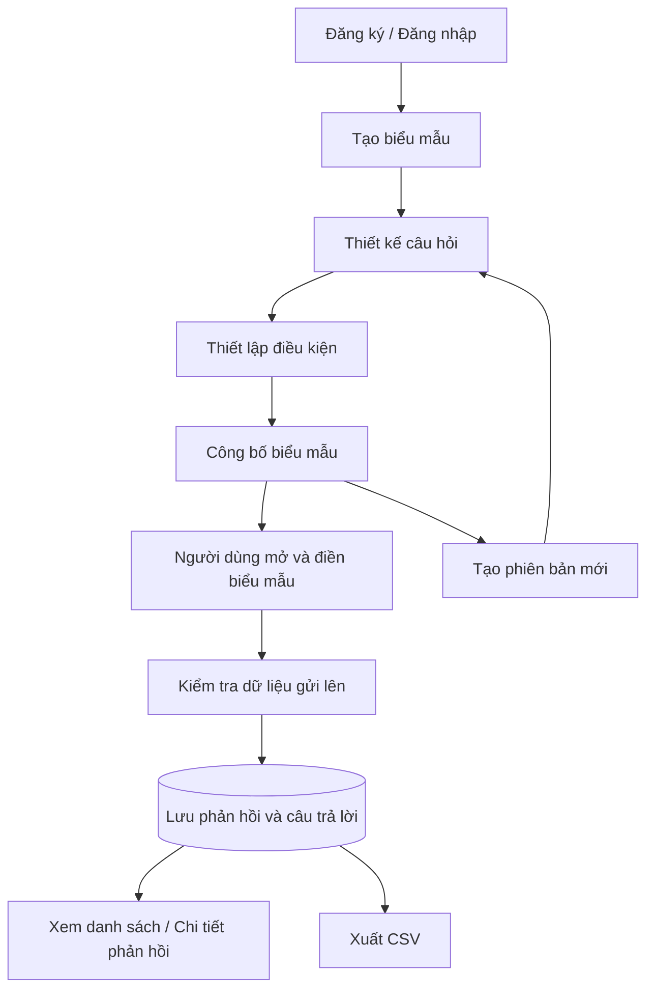

<div align="center">

# Formly – Hệ thống quản lý biểu mẫu

### Thiết kế biểu mẫu · Điều kiện hiển thị · Thu thập và quản lý dữ liệu

Ứng dụng PHP và MySQL hỗ trợ tạo biểu mẫu trực tuyến, thiết lập câu hỏi,
điều kiện hiển thị theo câu trả lời, công bố biểu mẫu và quản lý dữ liệu phản hồi.


</div>

---

## ✨ Giới thiệu

**Formly** là hệ thống quản lý biểu mẫu được xây dựng bằng PHP thuần và MySQL.
Người thiết kế có thể tạo biểu mẫu, thêm các loại câu hỏi, cấu hình điều kiện,
công bố phiên bản và theo dõi câu trả lời được gửi về hệ thống.

Dữ liệu biểu mẫu được tổ chức theo phiên bản. Mỗi lượt trả lời liên kết với
phiên bản cụ thể đã được công bố, giúp phân biệt dữ liệu thu thập ở các lần
thay đổi biểu mẫu.

## 🚀 Chức năng chính

| Nhóm chức năng | Nội dung |
| --- | --- |
| Tài khoản | Đăng ký, đăng nhập và đăng xuất; mật khẩu được lưu dưới dạng hash |
| Quản lý biểu mẫu | Tạo biểu mẫu, xem danh sách, theo dõi trạng thái bản nháp/đã công bố/lưu trữ |
| Thiết kế biểu mẫu | Thêm và xóa câu hỏi; hỗ trợ văn bản, số, ngày, lựa chọn đơn và lựa chọn nhiều |
| Điều kiện | Thiết lập điều kiện hiện, ẩn hoặc bắt buộc câu hỏi dựa trên câu trả lời của câu hỏi khác |
| Công bố | Kiểm tra biểu mẫu có câu hỏi và các câu hỏi lựa chọn có đủ phương án trước khi công bố |
| Phiên bản | Tạo phiên bản mới từ biểu mẫu hiện tại và sao chép cấu hình trường, điều kiện |
| Thu thập dữ liệu | Hiển thị biểu mẫu đã công bố, kiểm tra dữ liệu và lưu câu trả lời |
| Quản lý phản hồi | Xem danh sách phản hồi và chi tiết từng lượt trả lời |
| Xuất dữ liệu | Xuất dữ liệu phản hồi ra tệp CSV |
| Phân quyền | Có chức năng cấp quyền xem phản hồi và xuất dữ liệu theo từng biểu mẫu |

## 🧭 Luồng hoạt động



## 🛠 Công nghệ sử dụng

- **Backend:** PHP thuần, PDO.
- **Cơ sở dữ liệu:** MySQL, sử dụng khóa ngoại và kiểu dữ liệu JSON.
- **Frontend:** HTML, CSS và JavaScript.
- **Môi trường chạy đề xuất:** XAMPP trên Windows.
- **Trình quản lý cơ sở dữ liệu:** phpMyAdmin hoặc MySQL command line.

### Yêu cầu môi trường

- PHP **8.1 trở lên**.
- MySQL **8.0 trở lên** hoặc phiên bản MariaDB tương thích với schema.
- Apache và extension `pdo_mysql`, `mbstring`.
- Trình duyệt web hiện đại.

## 📦 Cài đặt với XAMPP

### 1. Sao chép source code

Giải nén dự án vào thư mục `htdocs` của XAMPP. Ví dụ:

```text
C:\xampp2\htdocs\QuanLyBieuMau
```

Nếu XAMPP được cài ở đường dẫn khác, hãy thay đổi cho phù hợp.

### 2. Khởi động dịch vụ

Mở XAMPP Control Panel và bật:

```text
Apache
MySQL
```

### 3. Tạo cơ sở dữ liệu

Mở phpMyAdmin:

```text
http://localhost/phpmyadmin
```

Import file `schema.sql`. File này tạo cơ sở dữ liệu `quanlybieumau` và các bảng:

- `users`: tài khoản người dùng.
- `forms`: thông tin biểu mẫu.
- `form_versions`: các phiên bản biểu mẫu.
- `fields`: các trường/câu hỏi.
- `conditions`: điều kiện hiển thị và bắt buộc.
- `responses`: các lượt gửi biểu mẫu.
- `answers`: câu trả lời của từng lượt gửi.
- `form_permissions`: quyền xem và xuất dữ liệu.

### 4. Cấu hình kết nối MySQL

Mở file `config/database.php` và kiểm tra thông tin kết nối:

```php
$host = '127.0.0.1';
$dbname = 'quanlybieumau';
$username = 'root';
$password = '';
```

Nếu tài khoản MySQL trên máy có mật khẩu, hãy điền mật khẩu vào `$password`.
Không sử dụng cấu hình mặc định này cho môi trường triển khai công khai.

### 5. Mở ứng dụng

Truy cập địa chỉ:

```text
http://localhost/QuanLyBieuMau/index.php
```

Nếu thư mục dự án hoặc cổng Apache khác, hãy thay URL tương ứng.

## 🖥 Các trang trong ứng dụng

| Tệp | Chức năng |
| --- | --- |
| `index.php` | Trang tổng quan |
| `forms.php` | Danh sách biểu mẫu |
| `form_create.php` | Tạo biểu mẫu mới |
| `form_builder.php?id=1` | Thiết kế câu hỏi cho biểu mẫu có ID tương ứng |
| `conditions.php?id=1` | Thiết lập điều kiện cho biểu mẫu |
| `publish.php?id=1` | Công bố biểu mẫu |
| `version_new.php?id=1` | Tạo phiên bản mới |
| `fill.php?id=1` | Trang điền biểu mẫu đã công bố |
| `responses.php` | Danh sách phản hồi mà tài khoản có quyền xem |
| `response_view.php?id=1` | Chi tiết một lượt phản hồi |
| `export.php?form_id=1` | Xuất phản hồi của biểu mẫu ra CSV |
| `permissions.php?id=1` | Cấp quyền xem và xuất dữ liệu |
| `login.php` | Đăng nhập |
| `register.php` | Đăng ký |
| `logout.php` | Đăng xuất |

Thay `1` bằng ID biểu mẫu hoặc phản hồi thực tế trong cơ sở dữ liệu.
Một số trang yêu cầu người dùng đăng nhập và có quyền phù hợp.

## 📝 Các loại câu hỏi

Dự án hiện khai báo các loại trường sau:

- `text`: câu trả lời dạng văn bản.
- `number`: câu trả lời dạng số.
- `date`: ngày tháng.
- `single_choice`: chọn một phương án.
- `multiple_choice`: chọn nhiều phương án.

Với câu hỏi lựa chọn, cần cấu hình tối thiểu hai phương án trước khi công bố.
Các quy tắc kiểm tra dữ liệu được lưu trong `validation_json` và được xử lý
ở phía máy chủ khi gửi biểu mẫu.

## 🔀 Điều kiện biểu mẫu

Điều kiện được lưu trong bảng `conditions`, không sử dụng `eval`.
Các toán tử được hỗ trợ trong mã nguồn gồm:

- `equals`: bằng.
- `not_equals`: không bằng.
- `contains`: có chứa.
- `greater_than`: lớn hơn.
- `less_than`: nhỏ hơn.
- `is_empty`: để trống.
- `is_not_empty`: không để trống.

Hành động có thể áp dụng lên câu hỏi đích:

- `show`: hiển thị câu hỏi.
- `hide`: ẩn câu hỏi.
- `require`: yêu cầu bắt buộc trả lời.

## 🗂 Cấu trúc dự án

```text
QuanLyBieuMau/
├── assets/
│   ├── auth.css
│   ├── form_builder.css
│   └── style.css
├── config/
│   └── database.php
├── includes/
│   ├── logout.php
│   └── schema_helpers.php
├── admin/
│   └── forms.php
├── index.php
├── forms.php
├── form_create.php
├── form_edit.php
├── form_builder.php
├── field_edit.php
├── field_delete.php
├── conditions.php
├── publish.php
├── version_new.php
├── fill.php
├── submit.php
├── responses.php
├── response_view.php
├── export.php
├── permissions.php
├── login.php
├── register.php
├── logout.php
├── schema.sql
└── README.md
```

## 🔐 Lưu ý bảo mật và triển khai

- Chỉ chạy thử trên máy local cho đến khi hoàn thiện việc rà soát bảo mật.
- Không đưa mật khẩu cơ sở dữ liệu, thông tin tài khoản hoặc dữ liệu phản hồi thật lên GitHub công khai.
- Cần bảo đảm mọi thao tác đọc, sửa, xóa, xem phản hồi và xuất dữ liệu đều được kiểm tra quyền ở phía máy chủ.
- Cần kiểm tra cấu hình session, CSRF, xác thực đầu vào và xử lý lỗi trước khi triển khai Internet.
- Tài khoản đăng ký mới được gán vai trò `designer` theo mã nguồn hiện tại.
- Không tự tạo tài khoản demo hoặc mật khẩu mặc định nếu chưa có dữ liệu seed tương ứng.

## ⚠️ Ghi chú về trạng thái mã nguồn

README này mô tả chức năng được tìm thấy trong source code tại thời điểm viết, không khẳng định toàn bộ chức năng đã được kiểm thử thành công trên mọi cấu hình máy.
Trước khi demo hoặc triển khai, cần import schema và chạy thử từng luồng. Đặc biệt,
cần đối chiếu cấu trúc cột trong `schema.sql` với các truy vấn PHP của phiên bản source đang sử dụng; nếu đã thay đổi cấu trúc bảng trong quá trình phát triển,
hãy cập nhật schema tương ứng.

## 📄 Giấy phép

Chưa thấy thông tin giấy phép mã nguồn được khai báo trong bộ source hiện tại.
Nếu dự định công khai hoặc cho phép người khác sử dụng lại dự án, hãy bổ sung file `LICENSE` phù hợp.
